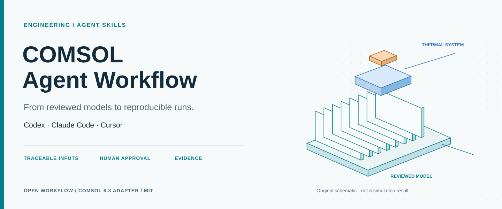
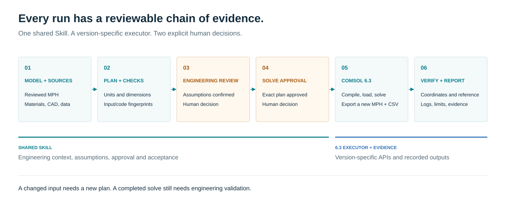
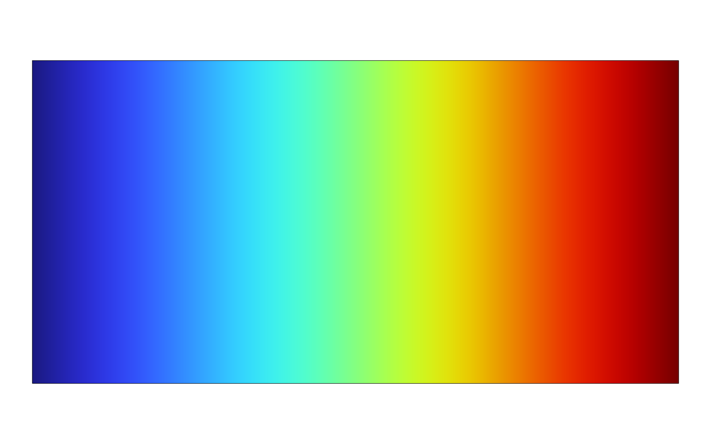
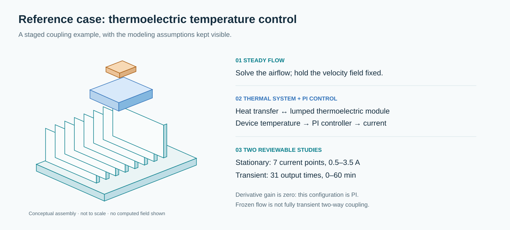

# COMSOL Agent Workflow



[](https://github.com/Wangrunze166/comsol-agent-workflow/actions/workflows/check.yml)
[](LICENSE)
[](pyproject.toml)
[](adapters/comsol63/README.md)

[中文](README.md) · **English** · [Examples](docs/demonstration.md) · [Evidence](docs/validation-status.md) · [Issues](https://github.com/Wangrunze166/comsol-agent-workflow/issues/new/choose)

**A COMSOL engineering workflow for Codex, Claude Code and Cursor: review the model, inspect its inputs, obtain human signatures, and deliver a traceable calculation.**

The shared Agent Skill handles engineering context and review. A separate Windows executor targets COMSOL 6.3. Its scope is parameterized reruns of reviewed MPH files; new geometry, physics and model families enter through dedicated builders or newly reviewed models.

**v0.2 completed a real local heat-plate solve: both user Ed25519 approvals verified, inspection and execution took about 69.63 seconds combined, and the mean temperature matched the analytic solution.** This demonstrates the single-physics execution chain, not full multiphysics or engineering validation.

## Capabilities

| Stage | Behavior |
| --- | --- |
| Input validation | Units, dimensions, ranges, sources and expected result coordinates |
| Load-only inspection | `smoke` / `dry-run` loads the model and checks tags and references without solving or saving a new MPH |
| Parameter scope | Java API inventory of geometry/mesh properties and parameter expressions; direct or indirect dependencies block a `physics_scalar` override |
| Human approval | Separate `approve` command; Ed25519 receipts bind assumptions and the exact solve or resume action |
| Execution evidence | Launcher and COMSOL logs, completion token, metrics CSV, output MPH and report; exit code zero alone is insufficient |
| Recovery | A new plan from actual recovery files, using `loadRecovery` / `continueRun`; no silent restart from scratch |
| Postprocessing | Real-valued global metrics, with optional PNG export of a configured field plot and a table with units |

The approval boundary depends on a **user-controlled signing key, protected trust anchor and trusted executor**. A TTY is an interaction check, not proof of human presence. Keep signing secrets outside agent access. A repository script cannot prevent bypass when the agent has the same unrestricted system privileges as the operator. See [approval security](docs/approval-security.md).

## Architecture



| Layer | Responsibility | Entry point |
| --- | --- | --- |
| Shared Skill | Recover sources, organize engineering review, diagnosis and validation | [SKILL.md](skills/comsol-multiphysics/SKILL.md) |
| Case and plan | Parameters, acceptance criteria, fingerprints and approval binding | [Case format](docs/case-format.md) |
| COMSOL 6.3 executor | Native inspection, reviewed solver sequence, recovery and export | [Adapter](adapters/comsol63/README.md) |

Changed inputs or execution code require a new plan and signatures. Solver completion remains separate from mesh independence, conservation and experimental validation.

## Quick start

Offline planning and CSV comparison require Python 3.10+. Signed approvals use the optional `cryptography` dependency.

```console
git clone https://github.com/Wangrunze166/comsol-agent-workflow.git
cd comsol-agent-workflow
python -m comsol_workflow --help
python -m comsol_workflow compare examples/offline/actual.csv examples/offline/reference.csv --coordinate time_s --atol 0.01 --rtol 0.001
python -m comsol_workflow plan examples/minimal-heat-plate/case.json --out runs/first-review
```

The CSV inputs are synthetic test data. Public examples omit MPH files, so the plan reports missing inputs and an unspecified COMSOL installation. It creates a review bundle, starts no solve and grants no approval. Use a new empty directory for each plan.

For development checks and signing support:

```console
python -m pip install -e ".[approval]"
python -m unittest discover -s tests -v
```

Real execution requires Windows, COMSOL 6.3, valid module licenses, a reviewed model and signed human approvals. Follow the [demonstration guide](docs/demonstration.md) to inspect the model before the operator approves assumptions and computation.

## Minimal example: steady heat plate

[minimal-heat-plate](examples/minimal-heat-plate/README.md) contains a readable Java builder and case manifest: a 10 × 5 mm 2D rectangle, 293.15 K on the left, 303.15 K on the right, insulated top/bottom and no internal source. Its analytic mean temperature is **298.15 K**.



*Actual 1600 × 1000 PNG exported by COMSOL 6.3.0.290: 293.15 K at the left boundary and 303.15 K at the right. This is the heat-plate result, not evidence of multiphysics validation.*

The builder first saved an unsolved model. After the user signed the assumptions and solve approvals, the executor calculated **298.1500000000019 K** for the mean temperature: an absolute analytic error of about **1.93 × 10⁻¹² K**, below the 0.001 K threshold.

Preflight inspection took **32.711377 s** and the execution stage **36.913876 s**, totaling **69.625253 s**, including each stage's compilation and batch process but excluding human input time. Original logs, token, signed receipts, metrics, table, PNG and new MPH were retained. [Measured metrics](examples/minimal-heat-plate/verified-results/metrics.csv) · [Table with units](examples/minimal-heat-plate/verified-results/global-results.csv). This single local measurement is not a runtime guarantee for other models or machines.

## Engineering reference: thermoelectric PI control



The retained manifests follow [COMSOL Application ID 102421](https://www.comsol.com/model/lumped-thermoelectric-module-with-pid-control-102421): a 7-point stationary current sweep and 31 transient output times over 60 minutes. Airflow is solved first, then held fixed for the thermal calculation. Zero derivative gain makes this configuration **PI control**.

The thermoelectric illustration in this section is an original conceptual diagram, not a computed field. Obtain authorized official models separately. Historical calculations are not counted as validation of this executor.

## Evidence matrix

| Evidence | Current boundary |
| --- | --- |
| Offline tests and CI | See the test workflow and [validation record](docs/validation-status.md); these do not prove COMSOL execution |
| Minimal builder compilation and execution | Passed locally on COMSOL 6.3.0.290; saved with `sol1.isEmpty=true` |
| New executor load-only smoke | This signed plan's preflight passed in 32.711377 s; unsafe geometry/mesh overrides and invalid study tags were separately rejected in native tests |
| User approvals and result exports | Both real Ed25519 receipts verified; PNG, metrics, table with units and new MPH generated |
| Minimal real solve and numerical baseline | **Passed**; mean 298.1500000000019 K, absolute error about 1.93 × 10⁻¹² K |
| Interrupted-run recovery | Compilation and simulated tests only; **real interruption/recovery remains unverified**; this successful run's recovery directory was cleaned up |
| Mesh/time-step independence, conservation and experimental validation | **Not completed** |
| Codex, Claude Code and Cursor | Shared Skill and project entry points; native loading has not been tested in every client |

## Use with an agent

Choose a client and copy the authoritative Skill into its project-local discovery directory:

```console
python scripts/install_skill.py --client codex --project .
```

`--client` also accepts `claude` or `cursor`; existing copies are not overwritten. The repository provides `AGENTS.md`, `CLAUDE.md` and a Cursor rule. Ask the agent to recover engineering inputs, prepare a plan and perform load-only inspection. The operator signs decisions in a trusted environment.

## Documentation and custom work

- [Workflow](docs/workflow.md), [case format](docs/case-format.md) and [interface sources](docs/interface-sources.md)
- [Model review template](templates/model-configuration.template.md) and [verification plan](templates/verification-plan.template.md)
- [Contributing](CONTRIBUTING.md), [issues](https://github.com/Wangrunze166/comsol-agent-workflow/issues/new/choose) and [release steps](docs/release.md)
- [Custom development](docs/commercialization.md): model onboarding, domain builders, solver diagnosis, team deployment and reproducible reports, scoped to explicit acceptance criteria.

Engineering and presentation references are **FreeCAD, Taichi, MuJoCo and Open3D**. Each exceeded 10K GitHub stars when checked through the API on 2026-11-04. See [counts and pinned source links](docs/high-star-engineering-references.md) and [presentation references](docs/presentation-references.md). Project text and illustrations are original.

## License

Original code, Skills, templates and illustrations use [MIT](LICENSE). COMSOL software, modules, trademarks, official models and customer materials retain their respective terms and are not distributed here. This independent project is not affiliated with or endorsed by COMSOL.
