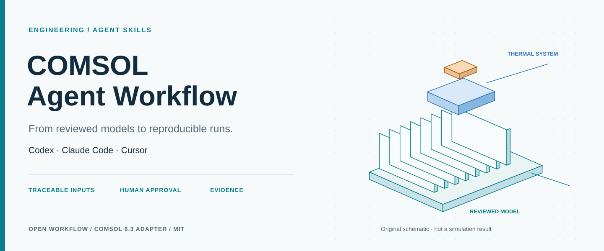
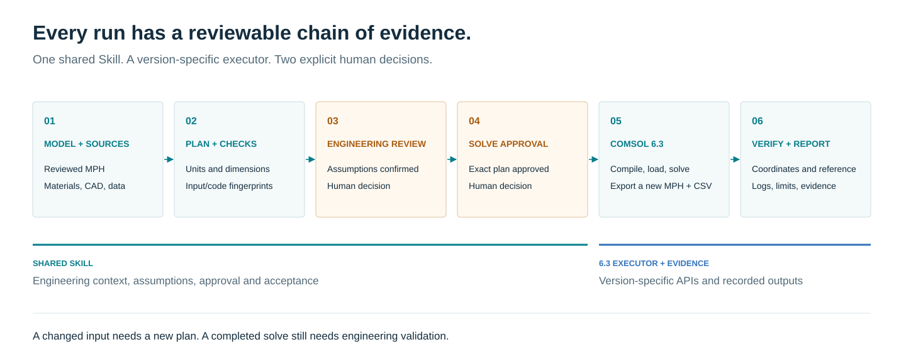
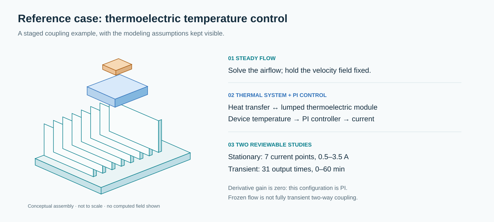

# COMSOL Agent Workflow



[](https://github.com/Wangrunze166/comsol-agent-workflow/actions/workflows/check.yml)
[](LICENSE)
[](pyproject.toml)
[](adapters/comsol63/README.md)

**中文** · [English](README.en.md) · [快速开始](#快速开始) · [完整演示](docs/demonstration.md) · [验证记录](docs/validation-status.md)

**让 Codex、Claude Code 和 Cursor 围绕你的 COMSOL 模型，完成可审阅、可复现的仿真工作流。**

将模型来源、参数单位、工程假设、求解审批、计算日志和验证报告连接起来。通用 Agent Skill 处理工程流程，COMSOL 6.3 执行器负责具体计算接口；工程师确认假设，并在实际求解前批准对应计划。

首版面向 **已审阅 MPH 的参数化复算与全局结果导出**。几何、材料、物理场、网格和求解器的配置有审阅模板；全新模型或新领域需要针对性接入。

## 适合哪些工作

| 工作 | 项目提供的支持 |
|---|---|
| 复现一个已有模型 | 记录输入来源、完整研究序列、输出表达式和参考数据 |
| 将计算交给 AI 助手 | 共享 Skill、明确工程假设和实际求解两个审批点 |
| 追踪参数变化 | 单位/量纲/范围检查，模型与执行代码指纹，过期审批拦截 |
| 判断一次运行是否完成 | 检查退出码、当前运行标记、结果坐标、指标及参考误差 |
| 交付可复算成果 | 保留计划、审批、日志、CSV、新 MPH、文件哈希与报告 |

## 从模型到报告



输入或代码变化后重新生成计划。执行完成后仍要按约定检查守恒、网格、时间步和实验一致性；未执行的验证保持未验证。

## 快速开始

离线流程只需 **Python 3.10+**，没有第三方运行依赖，也不需要 COMSOL。

```console
git clone https://github.com/Wangrunze166/comsol-agent-workflow.git
cd comsol-agent-workflow
python -m comsol_workflow --help
python -m unittest discover -s tests -v
python -m comsol_workflow compare examples/offline/actual.csv examples/offline/reference.csv --coordinate time_s --atol 0.01 --rtol 0.001
```

上述 CSV 是明确标注的合成数据。随后生成一个不会启动求解的审阅包：

```console
python -m comsol_workflow plan examples/thermoelectric-pid/case.json --out runs/first-review
```

打开 `runs/first-review/REVIEW.md`。公开示例不附 MPH，因此计划会列出缺失模型和 COMSOL 路径，两份审批均保持 `false`。这是可预期的审阅状态。

实际求解需要 **Windows、COMSOL 6.3、所需模块的有效许可、已审阅模型和两份人类审批**。完整命令见 [演示说明](docs/demonstration.md)；输入格式见 [案例说明](docs/case-format.md)。可选 `python -m pip install -e .` 安装命令行入口。

## 在 AI 编程工具中使用

三个客户端共用 [comsol-multiphysics Skill](skills/comsol-multiphysics/SKILL.md)。选择一个客户端，在本仓库内复制到对应的项目 Skill 目录：

```console
python scripts/install_skill.py --client codex --project .
```

`--client` 也可选 `claude` 或 `cursor`。脚本不覆盖已有同名 Skill；更新时从 `skills/` 同步。仓库也包含 `AGENTS.md`、`CLAUDE.md` 与 Cursor 规则入口。客户端发现路径与官方来源见 [接口依据](docs/interface-sources.md)。

可以直接给助手这样的任务：

> 按本仓库的 comsol-multiphysics Skill 准备这个案例。先核实模型与来源，生成可审阅计划；列出工程假设，并在实际求解前取得我的批准。每项验证结论都附证据。

## 参考案例：热电模块与温度控制



以 [COMSOL 官方案例 102421](https://www.comsol.com/model/lumped-thermoelectric-module-with-pid-control-102421) 的复现工作为参考，提供两个案例清单：

- **稳态电流扫描**：0.5–3.5 A，共 7 点；检查器件温度、TEM 热流率与温差。
- **瞬态温控**：0–60 min，每 2 min 输出，共 31 点；增加电流与器件功率。

模型先求稳态流场，再固定流场进行热学计算。微分增益为零，因此这一配置实际是 **PI**。图示均为原创概念图，颜色区分组件，不表示计算温度或其它场结果。官方模型由使用者按许可自行获取。

## 目前验证到哪一步

| 项目 | 状态 |
|---|---|
| 单位、数据、审批和执行状态检查 | 36 项离线测试通过 |
| GitHub CI | Windows/Linux × Python 3.10/3.13，4 个环境通过 |
| COMSOL 6.3 Java API | 本机 6.3.0.290 编译通过 |
| 三端 Skill 分发 | 项目目录复制与拒绝覆盖检查通过；原生加载尚未逐端实测 |
| 新执行器实际加载与求解 | **尚未执行** |
| 网格、时间步、守恒、实验验证 | **尚未执行** |

完整证据与 CI 状态见 [验证记录](docs/validation-status.md)。历史参考案例的重算结果不作为新执行器实测通过的证据。日志诊断给出排查线索，不自动承诺收敛；本版本导出实数全局量，复杂场图或复数结果需要后续适配。

## 文档与扩展

- [全流程与职责](docs/workflow.md) · [6.3 接口实现](adapters/comsol63/README.md)
- [几何与物理配置模板](templates/model-configuration.template.md) · [工程验证模板](templates/verification-plan.template.md)
- [参与开发](CONTRIBUTING.md) · [报告问题或提出需求](https://github.com/Wangrunze166/comsol-agent-workflow/issues/new/choose)
- [定制开发路径](docs/commercialization.md) · [发布与维护](docs/release.md)

可围绕客户模型接入、领域建模模板、求解诊断、团队部署与验证报告开展定制开发。先从一个明确模型族和可验收指标开始；[定制需求入口](https://github.com/Wangrunze166/comsol-agent-workflow/issues/new?template=customization.yml) 仅填写可公开的概况。

## 许可与来源

原创代码、Skill、模板和图示采用 [MIT](LICENSE)。COMSOL 软件、模块、商标、官方模型及客户资料保留各自权利，不随本仓库分发。本项目独立维护，不代表 COMSOL 官方。

介绍页的组织参考了 PyVista、SU2、MOOSE 和 DOLFINx；图文为本项目原创，参考链接见 [页面设计来源](docs/presentation-references.md)。
