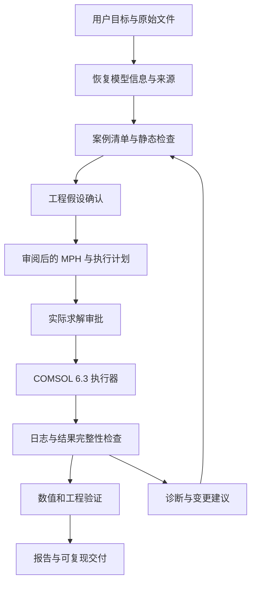

# 全流程工作规范

## 两层结构

通用 Skill 面向问题定义、证据、假设、验证与交付；COMSOL 6.3 执行器面向模型文件、明确标签、API 调用与运行记录。新增物理场时，先完成工程配置与审阅，再扩展有证据的执行能力。

图中的回路不代表自动无限重试。变更输入、求解配置或假设后重建计划，并重新取得适用的审批。

## 阶段与完成条件

| 阶段 | 核心工作 | 完成条件 / 交付证据 |
|---|---|---|
| 问题定义 | 明确工况、目标输出、验收标准和资源约束 | 可审核的目标、范围和验证阈值 |
| 输入恢复 | 读取模型、CAD、材料、已有报告和数据 | 每项信息有来源；缺失与冲突显式列出 |
| 假设确认 | 评估简化、耦合方向、材料/边界适用性 | 用户对具体假设的确认记录 |
| 几何与物理配置 | 检查域/边界、命名选择、材料、接口、耦合、初边值 | 审阅后的 MPH 与配置证据 |
| 网格与求解配置 | 检查分辨率、质量、研究步骤、缩放、初值、容差 | 选定求解序列、依赖关系和验证计划 |
| 执行准备 | 绑定输入与执行器、输出和资源限制 | 可读计划、哈希与环境检查结果 |
| 求解审批 | 用户审核本次具体计算 | 与当前计划匹配的 solve 审批 |
| 执行与诊断 | 编译、运行、保存日志和输出，处理失败证据 | 明确的完成或失败状态及原始记录 |
| 后处理 | 使用指定数据集、表达式、单位和坐标导出 | 可追溯的原始数据和指标 |
| 验证 | 参考解比较、守恒、网格/时间/容差/参数分析 | 逐项通过、失败、未做或不适用状态 |
| 报告与交付 | 汇总证据、限制、复算方式与输出 | 可复现包与工程结论的适用范围 |

## 从零建模的接入方式

几何和物理配置属于全流程的一部分。本 MVP 用审阅后的 MPH 作为执行接口，避免为所有物理场构造未经验证的抽象映射。新场景的交付包括：工程规格、配置过程、6.3 导出的 Java 证据、MPH、参数表、命名选择、网格/solver 说明和验收标准。

如定制开发需要自动从零构建，可增加面向具体领域的 Java builder。builder 应输出可审阅的未求解模型，明确哪些函数可能触发计算；它的代码、依赖与模型同样纳入计划哈希和人工审批。扩展前先在代表性模型上验证 feature 属性、标签和参数更新行为。

## 参数变化的分类

仅影响载荷或材料标量的覆盖也需确认作用域和允许范围。影响几何、选择、网格或求解结构的参数，不能依赖通用参数写入隐式完成全部重建，应在 6.3 中更新并审阅模型后进入下一次执行。

在热电参考案例中，稳态电流扫描和瞬态控制器使用不同工况定义；不能把一个模型的 `I0` 扫描当作另一个模型的控制电流覆盖。保留原始研究步骤和求解依赖，逐项验证新接口。

## 验证记录的含义

“全流程”指每个工程阶段有清晰输入、操作、审批和输出，并不意味着每个物理问题都能无人监督完成。发布说明只陈述本版本已运行的检查。真实求解完成后，仍需执行预定验证，才能形成相应工程结论。
